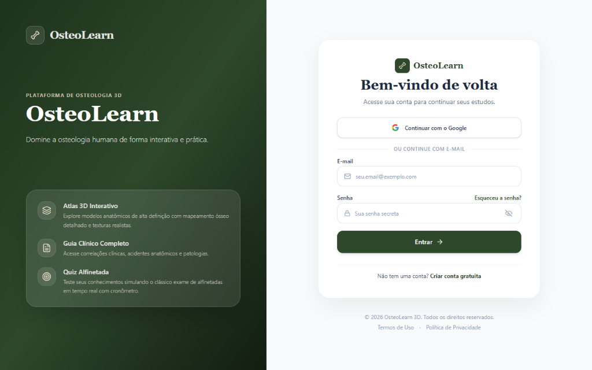
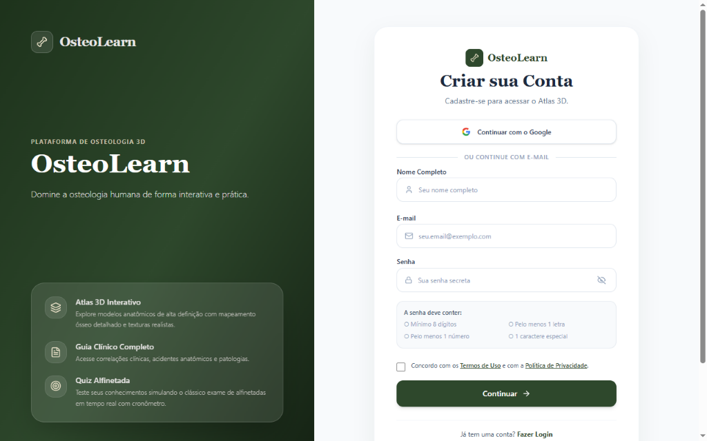
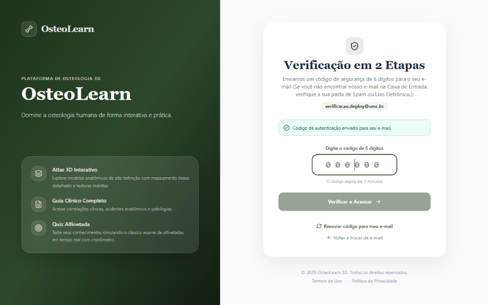
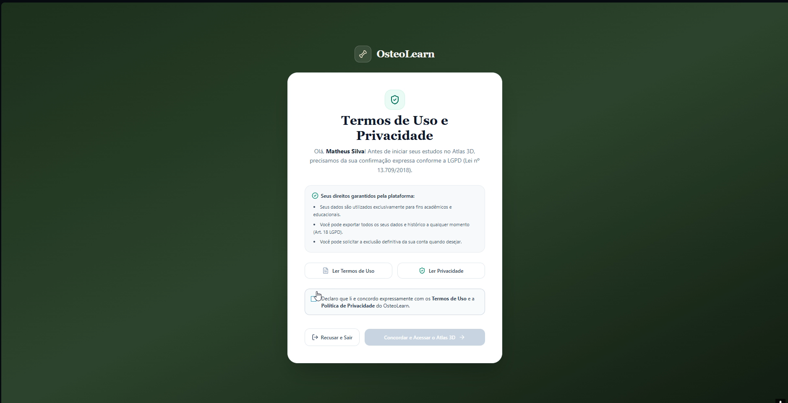
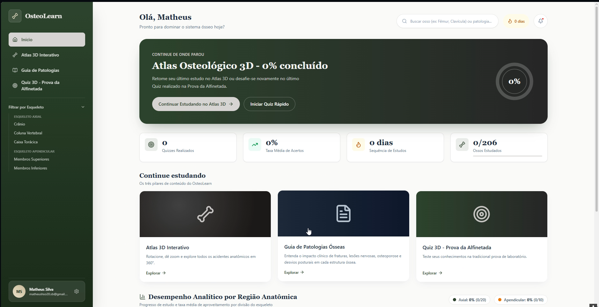
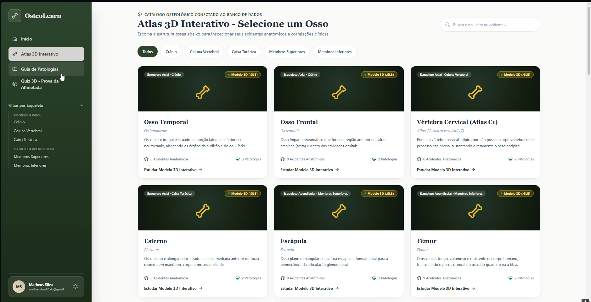
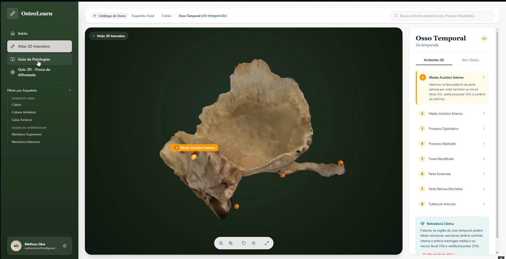
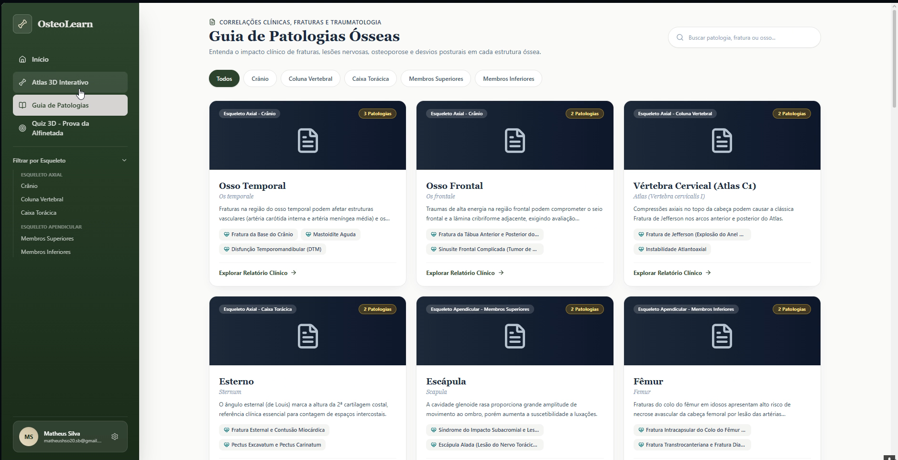
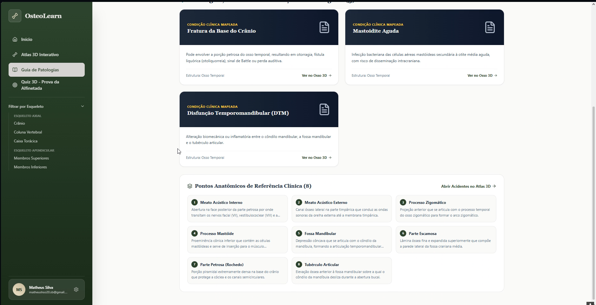
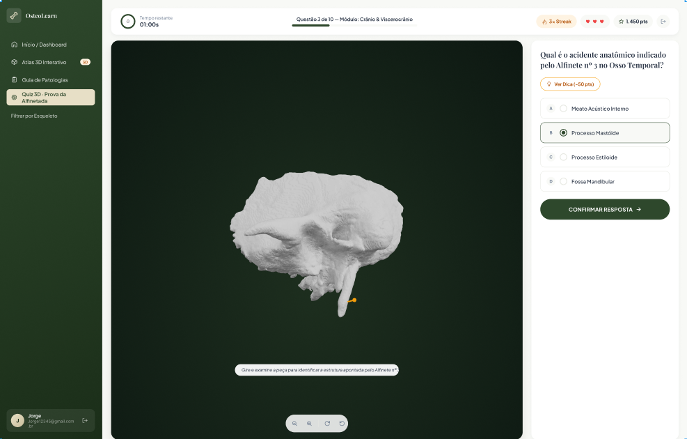

# Manual do Usuário - Plataforma OsteoLearn
### Ambiente Virtual Interativo para o Estudo de Osteologia Humana 3D

---

## Sumário
1. [Apresentação e Requisitos de Acesso](#1-apresentação-e-requisitos-de-acesso)
2. [Cadastro, Autenticação em 2 Etapas (2FA) e Login com Google](#2-cadastro-autenticação-em-2-etapas-2fa-e-login-com-google)
3. [Painel Inicial (Dashboard) e Central de Notificações](#3-painel-inicial-dashboard-e-central-de-notificações)
4. [Exploração no Atlas 3D Interativo](#4-exploração-no-atlas-3d-interativo)
5. [Guia Clínico de Patologias Ósseas](#5-guia-clínico-de-patologias-ósseas)
6. [Avaliação Prática: Quiz 3D ("Prova da Alfinetada")](#6-avaliação-prática-quiz-3d-prova-da-alfinetada)
7. [Configurações da Conta e Direitos do Titular (LGPD)](#7-configurações-da-conta-e-direitos-do-titular-lgpd)
8. [Módulo do Administrador (Gestão de Acervo, Questões, Avisos e Auditoria)](#8-módulo-do-administrador-gestão-de-acervo-questões-avisos-e-auditoria)

---

## 1. Apresentação e Requisitos de Acesso

O **OsteoLearn** é uma plataforma educacional web voltada a estudantes e docentes da área da saúde para o estudo tridimensional do esqueleto humano, correlação clínica de patologias ósseas e realização de simulados práticos no formato da tradicional "Prova da Alfinetada".

* **Endereço de Acesso Online:** https://osteo-learn.vercel.app
* **Requisitos de Navegador:** Google Chrome, Microsoft Edge, Mozilla Firefox, Brave ou Safari atualizados, com aceleração gráfica **WebGL 2.0** habilitada.
* **Dispositivos Recomendados:** Computadores, notebooks ou tablets com acesso à internet.

---

## 2. Cadastro, Autenticação em 2 Etapas (2FA) e Login com Google

### 2.1. Tela de Login e Acesso Rápido
1. Acesse a tela inicial do OsteoLearn. Você pode entrar utilizando seu **E-mail e Senha** ou clicar em **Continuar com o Google** para autenticação rápida via OAuth 2.0.

*Figura 1 - Tela de Login do OsteoLearn com opções de autenticação tradicional e Google OAuth 2.0.*

### 2.2. Criando uma Nova Conta de Estudante
1. Clique em **Criar conta gratuita** na parte inferior do cartão de acesso.
2. Preencha seu **Nome Completo**, seu **E-mail** e crie uma **Senha Forte** que atenda aos 4 requisitos exibidos em tempo real na tela:
   * Mínimo de **8 caracteres**;
   * Pelo menos **1 letra** (maiúscula ou minúscula);
   * Pelo menos **1 número** (`0-9`);
   * Pelo menos **1 caractere especial** (ex.: `! @ # $ % & *`).
3. Leia os **Termos de Uso** e a **Política de Privacidade** e marque a caixa de seleção de consentimento da **LGPD**.
4. Clique em **Continuar**.

*Figura 2 - Tela de criação de conta com validação de senha forte em tempo real e aceite LGPD.*

### 2.3. Verificação em 2 Etapas (2FA por E-mail)
1. Ao criar sua conta ou realizar login com e-mail e senha, o sistema enviará automaticamente um **código numérico de 6 dígitos (OTP)** para o seu e-mail (válido por 5 minutos).
2. Digite os 6 dígitos na tela de **Verificação em 2 Etapas** e clique em **Verificar e Acessar**.
3. Caso não encontre o e-mail na Caixa de Entrada, verifique a pasta de *Spam/Lixo Eletrônico* ou clique em **Reenviar código para meu e-mail**.

*Figura 3 - Etapa de confirmação do código OTP de 6 dígitos enviado por e-mail.*

### 2.4. Termo de Consentimento LGPD no Primeiro Acesso Social
1. No primeiro login realizado via conta Google, o sistema apresenta o modal de **Termos de Uso e Privacidade** garantindo os direitos previstos na Lei nº 13.709/2018 (LGPD).
2. Marque a confirmação de leitura e clique em **Concordar e Acessar o Atlas 3D**.

*Figura 4 - Tela de confirmação expressa dos Termos de Uso e Política de Privacidade (LGPD).*

---

## 3. Painel Inicial (Dashboard) e Central de Notificações

Ao entrar na plataforma, você é direcionado ao **Dashboard do Estudante**, que reúne seus indicadores e atalhos de estudo:

* **Barra Superior de Busca Rápida:** Digite o nome de qualquer osso (ex.: *Fêmur*, *Clavícula*, *Temporal*) ou patologia para abrir diretamente a peça correspondente no visualizador 3D.
* **Indicador de Sequência de Estudos (Ofensiva):** Exibe quantos dias consecutivos você estudou ou realizou quizzes na plataforma.
* **Central de Notificações (Ícone de Sino):**
  * Localizada no canto superior direito ao lado do indicador de dias de estudo.
  * Toda nova conta recebe automaticamente uma notificação de boas-vindas incentivando o estudo da osteologia humana.
  * Ao clicar no sino, você visualiza a lista de avisos, pode clicar em uma notificação para marcá-la como lida, clicar em **Marcar lidas** ou abrir a **Central de Notificações em Tela Cheia**.
* **Card "Continue de Onde Parou":** Mostra o progresso percentual da sua última atividade no Atlas 3D ou Quiz e oferece atalhos diretos para **Continuar Estudando no Atlas 3D** ou **Iniciar Quiz Rápido**.
* **Indicadores Gerais e Desempenho Analítico por Região:** Apresenta o total de quizzes realizados, taxa média de acertos (`%`), sequência de dias, ossos estudados (`X/206`) e recomendações automáticas de revisão.

*Figura 5 - Dashboard principal do estudante com indicadores de progresso, busca rápida, sino de notificações e pilares de estudo.*

---

## 4. Exploração no Atlas 3D Interativo

### 4.1. Catálogo de Modelos 3D
1. No menu lateral esquerdo, clique em **Atlas 3D Interativo** (ou utilize os filtros rápidos de **Esqueleto Axial** e **Esqueleto Apendicular** na barra lateral).
2. Utilize os botões de filtro no topo para alternar entre *Todos*, *Crânio*, *Coluna Vertebral*, *Caixa Torácica*, *Membros Superiores* e *Membros Inferiores*, ou pesquise pelo nome comum ou científico (latim).
3. Clique em **Estudar Modelo 3D Interativo** no card do osso desejado.

*Figura 6 - Catálogo Osteológico 3D com filtros por região anatômica e busca instantânea.*

### 4.2. Interação com o Modelo 3D e Acidentes Anatômicos
Dentro do visualizador 3D, você pode manipular livremente a peça anatômica e consultar seus acidentes ósseos:

| Ação / Controle | Como Executar |
| :--- | :--- |
| **Rotacionar em 360°** | Clique e arraste com o **botão esquerdo** do mouse (ou 1 dedo em telas touch). |
| **Aplicar Zoom (Aproximar/Afastar)** | Role o **scroll** do mouse ou clique nos botões **`+`** e **`-`** na barra inferior do canvas 3D. |
| **Mover Lateralmente (Pan)** | Clique e arraste com o **botão direito** do mouse (ou 2 dedos em telas touch). |
| **Resetar Posição da Câmera** | Clique no ícone de **seta circular (Resetar câmera)** na barra inferior. |
| **Ajustar Iluminação da Malha** | Clique no ícone de **Sol (Alternar iluminação)** na barra inferior. |
| **Modo Tela Cheia** | Clique no ícone de **Expandir (Tela cheia)** na barra inferior. |
| **Ouvir Pronúncia Científica** | No painel lateral direito, clique no ícone de **alto-falante** ao lado do nome do osso. |
| **Inspecionar Acidente Anatômico** | Clique sobre qualquer **pino esférico numerado** na superfície do osso 3D ou selecione o item na lista **Acidentes** à direita para ler sua descrição anatômica detalhada. |

*Figura 7 - Visualizador 3D Interativo exibindo o modelo tridimensional do Osso Temporal, pinos espaciais e painel lateral de acidentes anatômicos.*

---

## 5. Guia Clínico de Patologias Ósseas

1. Acesse **Guia de Patologias** no menu lateral esquerdo (ou clique na aba **Rel. Clínica** dentro do visualizador 3D de qualquer osso).
2. Filtre as condições clínicas por região anatômica ou utilize o campo de busca para localizar fraturas, lesões nervosas, desvios posturais ou doenças metabólicas.
3. Clique em **Explorar Relatório Clínico** para visualizar as condições clínicas mapeadas daquele osso e, dentro do relatório, clique em **Ver no Osso 3D** para inspecionar a estrutura anatômica diretamente no modelo tridimensional.

*Figura 8 - Guia Clínico de Patologias Ósseas organizado por região anatômica e estrutura óssea.*

*Figura 9 - Detalhamento das condições clínicas mapeadas do osso com atalho direto para visualização no Atlas 3D.*

---

## 6. Avaliação Prática: Quiz 3D ("Prova da Alfinetada")

1. No menu lateral esquerdo, clique em **Quiz 3D - Prova da Alfinetada**.
2. Escolha como deseja ser avaliado:
   * **Simulado Geral:** Sorteia questões de diferentes ossos e regiões anatômicas;
   * **Prova por Osso Específico:** Avalia exclusivamente os acidentes anatômicos da peça óssea escolhida.
3. Durante a prova, você encontrará dois formatos de questões:
   * **Identificação Espacial 3D (`Prova da Alfinetada`):** O enunciado solicita que você localize um acidente anatômico específico. Rotacione o modelo 3D, identifique o pino posicionado sobre a estrutura correta e clique nele para confirmar.
   * **Múltipla Escolha com Destaque 3D:** Um pino aparece destacado sobre uma região do osso 3D. Inspecione a peça em 360° e selecione qual das 4 alternativas (`A`, `B`, `C` ou `D`) corresponde ao acidente apontado.
4. A cada resposta confirmada, o sistema informa imediatamente se você acertou ou errou e destaca a resposta correta. Ao concluir, sua nota e precisão (`%`) são salvas automaticamente no banco de dados.

*Figura 10 - Interface de avaliação prática na Prova da Alfinetada 3D com modelo interativo e validação de resposta.*

---

## 7. Configurações da Conta e Direitos do Titular (LGPD)

No canto inferior esquerdo da barra lateral, clique no **ícone de engrenagem (`Configurações da conta`)** ao lado do seu nome para acessar:

* **Exportar Dados (Art. 18 da LGPD):** Faz o download imediato de um arquivo `.json` estruturado contendo todos os seus dados cadastrais, métricas de estudo e histórico de acessos registrados.
* **Termos de Uso e Política de Privacidade:** Abre para leitura integral os documentos institucionais de uso e proteção de dados da plataforma.
* **Sair da Conta:** Encerra com segurança sua sessão atual e registra o logout na auditoria.
* **Excluir Minha Conta:** Abre a página dedicada de exclusão de conta. Caso deseje remover permanentemente seu cadastro e seu histórico de estudos, clique no botão vermelho **Excluir Minha Conta** (ou em **Cancelar** para retornar ao painel).

---

## 8. Módulo do Administrador (Gestão de Acervo, Questões, Avisos e Auditoria)

Usuários com perfil **Administrador (`ADMIN`)** visualizam a etiqueta `ADMIN` ao lado do nome e possuem ferramentas adicionais:

### 8.1. Calibração Direta de Pinos 3D no Visualizador
1. Abra qualquer osso no **Atlas 3D Interativo**.
2. Clique no botão superior direito **Calibrar Pinos 3D (Admin)**.
3. Selecione na lista lateral qual acidente anatômico (`#1`, `#2`, etc.) deseja ajustar e clique diretamente sobre o ponto exato na superfície do modelo 3D. As novas coordenadas `(X, Y, Z)` são salvas automaticamente no banco de dados.

### 8.2. Painel de Gestão Administrativa
Clique no ícone de engrenagem no canto inferior esquerdo e selecione **Gestão do Acervo e Auditoria (Admin)**:

1. **Aba "Modelos Anatômicos 3D":** Cadastre novas peças ósseas ou edite modelos existentes informando nome, nome científico, região, divisão do esqueleto, resumo clínico, marcadores `(X, Y, Z)` e arquivo `.glb` (com validação binária glTF 2.0 automática).
2. **Aba "Cadastro de Questões":** Crie novas questões vinculadas a um osso, escolhendo entre *Múltipla Escolha* ou *Identificação Espacial 3D*, e utilize os botões **Editar**, **Desativar/Ativar** e **Excluir** para gerenciar o banco de questões.
3. **Aba "Notificações e Avisos":** Publique comunicados para **Todos os Estudantes** ou para um **Estudante Específico (E-mail)**, com opção de enviar cópia por e-mail ou acionar o **Canal Externo de Contingência (HTTPS Relay / PowerShell)** caso o servidor principal esteja em manutenção.
4. **Aba "Logs de Auditoria":** Consulte em tempo real os eventos de segurança registrados na plataforma.
